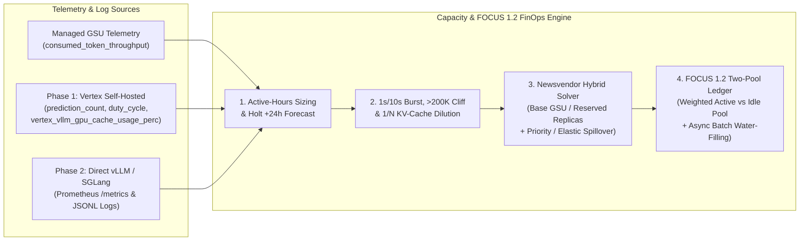

# Capacity — Enterprise AI Capacity Planner, Micro-Burst Simulator & FOCUS 1.2 FinOps Engine

`capacity` (`v0.2.0`) is an open-source capacity sizing, sub-second token-bucket & KV-cache simulator, Newsvendor hybrid commitment optimizer, and **FinOps FOCUS 1.2 Two-Pool Chargeback** engine for both **Managed Gemini Platform GSUs (`--mode gsu`)** and **Self-Hosted Open-Weight Models (`--mode self-hosted` on Vertex AI Endpoints & vLLM / SGLang clusters)**.

---

## Why Enterprise AI Capacity & Chargeback Models Break

Most teams size reserved AI capacity from monthly token totals or 60-second dashboard averages, then allocate the reservation invoice across business units by raw token count. In production, five physics and accounting traps break those spreadsheets in the first month:

1. **The 8x5 Diurnal Zero-Padding Trap (`ADR-001`):** An enterprise workload active `8 hours × 5 days` (`23.8%` weekly duty cycle) has `76.2%` zero-traffic minutes on nights and weekends. Computing `P50` or `P75` across all `10,080` weekly minutes recommends **`0 GSUs`**, starving daytime production. `capacity recommend --active-only` separates `active_hours` from `all_hours` and projects 24-hour growth via **Holt's Double Exponential Smoothing**.
2. **The 60-Second Monitoring Illusion (`1s` / `10s` Token Bucket, `ADR-002`):** Cloud Monitoring charts average throughput over 60 seconds, but admission control enforces a **`1-second` token bucket (`>=50 GSUs`)** or **`10-second` token bucket (`<50 GSUs`)** with a `5%` burst credit. A cluster appearing **`62%` utilized on a 60-second chart** still triggers HTTP 429s or PayGo spillover during sub-second agent fan-out bursts (`illusion_detected=True`).
3. **The `>200K` Context & Reasoning Burndown Cliff (`ADR-002`):** On reserved throughput pools, `1` output or reasoning token consumes **`4.0x`** the capacity of `1` input token (andcached prefixes consume `0.1x`). Crossing `200,000` input tokens doubles input weight to **`2.0x`** and jumps output/reasoning weight to **`7.5x`**.
4. **The Round-Robin $1/N$ Prefix-Cache Trap (`ADR-002` & `ADR-006`):** Behind $N = 8$ load-balanced endpoints or GPU replicas (`DeployedModel` / vLLM / SGLang), stateless L7 round-robin routes Turn 1 to Replica 1 and Turn 2 to Replica 2. Because KV-cache lives in replica-local HBM, an `80%` prefix-cache hit rate drops to **$h / N = 10.0\%$**, inflating uncached prefill burndown by `2.65x`.
5. **The Self-Hosted GPU Quota Lock & Duty-Cycle Illusion (`ADR-006`) + FOCUS 1.2 Idle Tax (`ADR-003`):**
   - On self-hosted GPU endpoints, regional accelerator quota locks upfront against **`max_replica_count × accelerators_per_replica`**, and `accelerator/duty_cycle` stays `<60%` during memory-bound decoding while `vllm:gpu_cache_usage_perc` hits `>90%` and triggers KV preemption.
   - In FinOps chargeback, billing teams by **unweighted raw tokens** underbills reasoning agents by `4x`, while dividing 24x7 commitment costs across active tokens punishes early adopters for 2 AM idle capacity.

---

## Architecture Overview



---

## Capability Status (`v0.2.0`)

| Capability | Mode / Flag | Status |
| :--- | :--- | :---: |
| **Managed GSU Percentile Sizing (`all_hours` + `active_hours`) & Holt `+24h` Forecast** | `capacity recommend --mode gsu` (`--demo` or live GCP) | **Implemented** |
| **Multi-Project & Departmental Folder Roll-Up** | `capacity recommend --project ... --folder-map ...` | **Implemented** |
| **Self-Hosted Vertex AI GPU Endpoint Sizing, Quota-Lock & KV-Cache Audit (Phase 1)** | `capacity recommend\|optimize --mode self-hosted` | **Implemented** |
| **vLLM / SGLang Prometheus `/metrics` & JSONL Request Log Ingestion (Phase 2 Seam)** | `--vllm-file examples/vllm_prometheus_metrics.txt` / `.jsonl` | **Implemented** |
| **Newsvendor Hybrid Commitment (`PT + Priority PayGo 1.8x` / `FSP`) & Micro-Burst Audit** | `capacity optimize` / `POST /api/v1/optimize` | **Implemented** |
| **FOCUS 1.2 Two-Pool Chargeback (Weighted vs. Raw Tokens + Batch Water-Filling)** | `capacity chargeback` / `POST /api/v1/chargeback` | **Implemented** |
| **Interactive GM3 Light Web Portal & OpenAPI REST Service** | `capacity serve` (`GET /`, `/docs`, `/healthz`) | **Implemented** |
| **Live K8s Pod `/metrics` Polling Daemon & Disaggregated Prefill/Decode Sizer** | Roadmap [`docs/roadmap.md`](docs/roadmap.md) (`v0.3.0`) | **Planned** |

---

## Quickstart (Zero Cloud Credentials Required)

Every command runs offline out of the box using built-in enterprise traces or [`examples/`](examples/):

### 1. Empirical Active-Hours Sizing + Holt 24h Forecast (`recommend --demo`)

```bash
uv run capacity recommend --demo --active-only --by-region
```

```text
Model             Region         TPM/GSU  Duty%  P50 TPM  P50 GSU  P75 TPM  P75 GSU  P90 TPM  P90 GSU  P95 TPM  P95 GSU  Forecast+24h TPM  Forecast GSU
————————————————  ————————————  ————————  —————  ———————  ———————  ———————  ———————  ———————  ———————  ———————  ———————  ————————————————  ————————————
gemini-3.8-flash  europe-west4   120,900  23.8%  241,800        2  241,800        2  241,800        2  241,800        2           120,900             1
gemini-3.8-flash  us-central1    120,900  23.8%  483,600        4  483,600        4  483,600        4  483,600        4           241,800             2
gemini-4-argon    us-central1     30,000  23.8%   90,000        3   90,000        3   90,000        3   90,000        3            60,000             2
```

### 2. Newsvendor Hybrid Commitment, `1s`/`10s` Micro-Burst & $1/N$ Prefix-Cache Audit (`optimize`)

```bash
uv run capacity optimize --model gemini-3.8-flash
```

```text
=== Newsvendor Hybrid Commitment (gemini-3.8-flash) ===
Optimal PT Base: 1 GSUs (Quantile=0.57, Break-Even Util=42.5%)
Monthly Cost:    $5,412.65 (PT=$2,000.00 + Spillover=$3,412.65)
Savings:         $553.58/mo vs 100% PayGo (9.3%), $2,587.35/mo vs P99 PT (32.3%)
Request Weight:  11,600 weighted burndown tokens (in=20,000, cached=16,000, out=1,000, thoughts=500)
Micro-Burst:     10s window | 60s Util=62.0% | Peak Window Util=112.2% | Spillover=True | Illusion=True
Prefix Cache:    Sticky=4 GSUs vs Round-Robin(8)=9 GSUs (Effective Hit=10.0%, Wasted=5 GSUs, Savings=56.0%)
```

### 3. Self-Hosted GPU Endpoint Audit & Phase 2 vLLM Log Ingestion (`--mode self-hosted`)

```bash
uv run capacity optimize --mode self-hosted --model llama-3.3-70b-fp8 --vllm-file examples/vllm_prometheus_metrics.txt
```

```text
=== Self-Hosted GPU Endpoint Audit (llama-3.3-70b-fp8 @ a3-highgpu-8g) ===
Upfront GPU Quota Lock: 64x NVIDIA_H100_80GB (min=2 reps -> 16 GPUs, stranded lock=48 GPUs)
Autoscaler Illusion:    Duty Cycle=52.0% (<60%) vs vLLM KV-Cache=91.5% (Wait Queue=14, Illusion=True)
Newsvendor Replicas:    2 Reserved CUD Reps (P99=3 Reps, Break-Even Util=66.2%)
Monthly Hybrid Cost:    $43,984.00 (Reserved=$37,000.00 + Elastic Burst=$6,984.00; Non-Prod ScaleToZero Saves=$35,923.20/mo)
Replica KV Dilution:    Sticky=3 Reps vs Round-Robin(8)=6 Reps (Effective Hit=10.0%, Savings=56.0%)
```

### 4. FinOps FOCUS 1.2 Two-Pool Chargeback (`chargeback`)

Shows both **Weighted Burndown vs. Unweighted Raw-Token Distortion** and **Active Pool vs. Naive Full-Pool Idle Penalty**:

```bash
uv run capacity chargeback --model gemini-3.8-flash --gsus 10 --waterfill-tpm 300000
```

```text
=== FOCUS 1.2 Two-Pool Chargeback (10 GSUs @ $2,000/mo) ===
Total Monthly Commitment:      $20,000.00
Active Consumed Capacity Pool: $6,617.04 (33.1% util)
Reclaimed Batch Water-Fill:    $3,970.22 (+19.9% util -> 52.9% effective)
Net Unallocated Idle Pool:     $9,412.74

Tenant                Weighted %  Raw Tok %  FOCUS Active $  Unweighted Raw $  Naive Full-Pool $  Idle Tax Avoided $
————————————————————  ——————————  —————————  ——————————————  ————————————————  —————————————————  ——————————————————
claims-triage              46.7%      27.8%       $3,087.95         $1,841.36          $9,333.33           $6,245.38
policy-audit               20.0%      49.0%       $1,323.41         $3,241.00          $4,000.00           $2,676.59
underwriting-copilot       33.3%      23.2%       $2,205.68         $1,534.68          $6,666.67           $4,460.99
```

---

## Documentation & Governance

- [`AGENTS.md`](AGENTS.md) — Repository map and verification commands
- [`CRITICAL.md`](CRITICAL.md) — Hard engineering and FinOps invariants
- [`DECISIONS.md`](DECISIONS.md) — Architectural Decision Records (`ADR-001`–`ADR-006`)
- [`docs/roadmap.md`](docs/roadmap.md) — Two-Phase roadmap (Managed GSUs + Self-Hosted Vertex AI -> Direct vLLM/SGLang Collectors)
