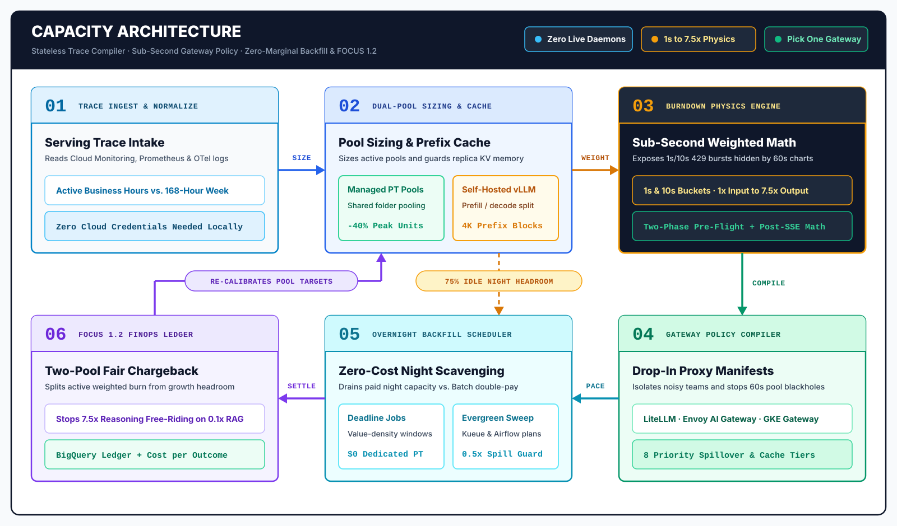
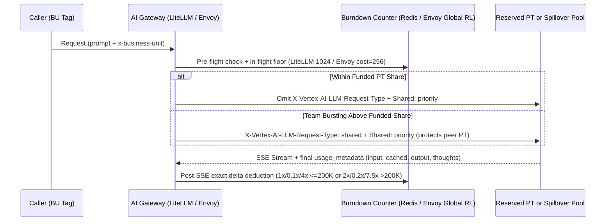

# capacity: why 24x7 AI reservations throttle at noon and pay twice at midnight



60-second charts hide `1s` and `10s` weighted `429` bursts (`1x` input to `7.5x` long-context decode) on Google Cloud Provisioned Throughput (`PT`) and self-hosted `vLLM`. Meanwhile, stateless gateways dilute prefix caches to `1/N` and blackhole pools for 60 seconds, while "50%-off" Batch APIs bill a second invoice as commitments sit `75%` idle overnight.

**`capacity`** runs offline with zero cloud credentials or live daemons. It compiles Cloud Monitoring, Prometheus, and OpenTelemetry traces into active-hours commitments, burst-isolating **LiteLLM, Envoy, or GKE** manifests, `$0` night backfill plans, and two-pool **FOCUS 1.2** chargeback ledgers.

> **Scope Boundary (One Stateless Compiler, Not Seven Daemons):** You do not deploy `capacity` in the request hot path or run all targets at once. Teams feed usage traces in, compile manifests for their **single** chosen gateway (`--target litellm | envoy | epp`), and export JSON sizing/chargeback tables to existing schedulers and data warehouses.

> **Measured Open-Loop Proof ([`l3_receipt.json`](benchmarks/results/l3_receipt.json)):** Across `10,000` Azure LLM trace arrivals and `1,500` live HTTP/1.1 SSE streams, `capacity` cuts 7-day cost **`43.03%`** vs. static active-`P99` (within `3.34%` of the hindsight oracle) with **`0.00%`** Tier-0 `429`s, **`0.00%`** burndown drift, and **`0`** peer `PT` starvations.

---

## 1. Six Month-1 Reservation Traps & Who Uses This

### Why Standard Capacity & Chargeback Models Break in Month 1

| Default Industry Habit | Month-1 Production or Financial Failure | Underlying Serving & FinOps Physics | Compiled `capacity` Output |
| :--- | :--- | :--- | :--- |
| **1. Sizing from 24x7 averages or per-project `P99`** | `P50 = 0 GSUs` on 8x5 workloads, or `60%+` overnight waste when each project reserves its own peak; self-hosted autoscaling locks `max_replicas * GPUs` upfront. | Business traffic runs `~23.8%` of the 168h week; `accelerator/duty_cycle` stays `<60%` while `vLLM` KV-cache hits `>85%` preemption. | Active-hours **Newsvendor** sizing, **Shared Folder Provisioned Throughput (`RHPT`)** follow-the-sun spoke pooling (`-40%` GSUs), and **Disaggregated Prefill/Decode** replica pools. |
| **2. Watching 60-second Cloud Monitoring charts** | Sudden HTTP `429` storms fire while 1-minute throughput charts sit calmly below `70%` utilization. | Serving quotas enforce **`1s` (`>=50` GSUs) or `10s` (`<50` GSUs)** token buckets (`+5%` burst credit), and `>200K` context prompts jump from `1x/4x` to **`2.0x` input / `7.5x` output+reasoning** burndown. | Sub-second conserved burst simulator (`illusion_detected`) and exact `<=200K` vs. `>200K` weighted burndown calculator (`capacity optimize`). |
| **3. Injecting dynamic UUIDs/timestamps at prompt top & round-robin GPU routing** | Prefix cache hit rate collapses to `0%` on block-aligned tiers (multi-turn routing affinity drops from `90%` to `0.77%` in `capacity/burst.py` when proxies strip `thought_signature`; Track B effective cache hit rate drops from `26.84%` to `0.25%`), and `N` replicas dilute hits to `h / N`. | Block-aligned tiers (`4,096`-token blocks, `6,144` floor) invalidate everything after a mutated **Block 0**; stateless load balancers re-prefill identical system prompts across every pod. | Model-tier prefix-cache linter (Block-0 check, Turn-0 dummy-turn anchor, `thought_signature` audit) and `GKE epp` prefix/KV scorer weights. |
| **4. Enforcing LiteLLM raw `tpm_limit` & default router `cooldown_time`** | Reasoning-heavy tenants blow through unweighted quotas, a 1s PT micro-burst `429` blackholes the entire PT deployment for 60s, and Prisma locks Postgres above `500 RPS`. | LiteLLM's native `tpm_limit` counts unweighted 60s raw tokens, and each Uvicorn worker spawns a separate Rust Prisma engine (`pods * workers` connections). | Tag-routed `litellm_config.yaml` (`cooldown_time` matched to `1s`/`10s` buckets + `use_redis_transaction_buffer`), stateful Redis `litellm_burndown_callback.py`, Envoy post-SSE `CEL`, and PgBouncer scale audit. |
| **5. Sending overnight async jobs to the `0.5x` Batch API** | Enterprise pays a **second variable invoice (`+0.5x`)** while already-paid 24x7 `PT` reservations sit `75%` idle from 8 PM to 6 AM. | Batch API jobs bypass `PT` reservations completely, whereas paced online calls with `X-Vertex-AI-LLM-Request-Type: dedicated` consume idle `PT` at **`$0.00` marginal cost**. | **Batch Double-Payment Auditor** and **3-Tier Residual Capacity Scheduler** (`Tier-0 Revenue > Tier-1 Exact Value-Maximizing EDF > Tier-2 Evergreen Water-Fill`). |
| **6. Dividing the monthly reservation invoice by raw token counts** | Reasoning agents (`4x-7.5x` decode weight) get subsidized up to `4x` by high-cache RAG teams (`0.1x`), and early adopters get punished `3x` for unallocated corporate headroom. | Raw token counts ignore compute burndown weights and conflate active consumption with unallocated capacity growth buffers. | **FinOps FOCUS 1.2 Two-Pool Chargeback** (*Active Consumed Pool* billed by weighted burndown vs. *Unallocated Idle Pool* held by platform) + **5 FinOps for AI KPIs**. |

### Who Uses `capacity`?

| Persona | Core Problem Solved | Primary Entrypoints |
| :--- | :--- | :--- |
| **1. AI Platform & Gateway Engineers** *(LiteLLM, Envoy AI Gateway, GKE `epp`)* | Stop unweighted `tpm_limit` leaks, `429` router cooldown blackholing, `>500 RPS` Prisma/Postgres locks, and `1/N` replica KV-cache dilution. | `capacity gateway --target litellm\|envoy\|epp`<br>`POST /api/v1/gateway/config` |
| **2. Cloud FinOps & Capacity Planners** *(GSU, Flexible Spend Plan `FSP`, GPU commitments & BU chargeback)* | Right-size commitments with Newsvendor quantiles, pool spoke projects under Shared Folder `RHPT`, stop `+0.5x` Batch double-pay, and run auditable FOCUS 1.2 chargeback. | `capacity recommend` · `capacity schedule`<br>`capacity chargeback` · `capacity demo` |
| **3. Applied AI & Self-Hosted Model Architects** *(Prompt caching & `vLLM` / `SGLang` clusters)* | Catch Block-0 prompt cache contamination and `thought_signature` stripping; separate compute-bound Prefill pools from bandwidth-bound Decode pools. | `capacity optimize --mode self-hosted`<br>`POST /api/v1/prefix-cache/model-tier` |

---

## 2. Quick Start: Run Locally in 10 Seconds (`0` Cloud Credentials)

Start with the single offline showcase command (generates the scorecard and the self-contained 4-tab GM3 Light HTML workbench in `< 2s`):

```bash
uv run capacity demo --html-out /tmp/capacity_scorecard.html
uv run capacity demo --scenario-file examples/scenarios/multi_tenant_enterprise.json --strict-public-check --html-out /tmp/enterprise_scorecard.html
```

### Bring Your Own Traces, Customer Logs, Gateways & Benchmarks

```bash
# 0. Collect Customer Cloud Monitoring Metrics & BigQuery `inference_request` Logs into a Scenario
uv run capacity collect --project my-gcp-project --check-auth
uv run capacity collect --logs-file examples/otel_genai_spans.jsonl --orders-file examples/orders_overlay.yaml --gateway-mode central_proxy --out /tmp/scenario.json

# 1. Bring Your Own Traces (JSON minute TPM, multi-scrape vLLM Prometheus, or OTel gen_ai.* JSONL)
uv run capacity recommend --trace-file examples/diurnal_8x5_trace.json --active-only
uv run capacity recommend --mode self-hosted --vllm-file examples/otel_genai_spans.jsonl --active-only

# 2. Built-in Multi-Region Reference Sizing + Daily-Peak Holt (+24h) Trend
uv run capacity recommend --demo --active-only --by-region
uv run capacity recommend --demo --mode self-hosted --active-only --by-region

# 3. Newsvendor Hybrid Commitment, 1s/10s Micro-Burst & Self-Hosted vLLM KV-Cache Audit
uv run capacity optimize --model gemini-3.8-flash --sixty-sec-tpm 150000 --peak-1s-tps 4750
uv run capacity optimize --mode self-hosted --model llama-3.3-70b-fp8 --vllm-file examples/vllm_prometheus_multiscrape.txt

# 4. Compile Production LiteLLM Proxy, Envoy AI Gateway (CEL) & GKE Inference Gateway (epp) Configs
uv run capacity gateway --target all --model gemini-3.8-flash --gsus 20 --rps 650

# 5. Compute 3-Tier Overnight Residual Schedule & FOCUS 1.2 Two-Pool Chargeback
uv run capacity schedule --model gemini-3.8-flash --gsus 20
uv run capacity chargeback --model gemini-3.8-flash --gsus 10 --tenant-file examples/chargeback_tenants.json --waterfill-tpm 300000

# 6. Replay or Re-Run the Open-Loop Level 3 Empirical Benchmark (10,000 Azure LLM Traces + Live SSE)
uv run python -m benchmarks.run_l3_benchmark --offline

# 7. Launch the Interactive 4-Tab Web Workbench & OpenAPI Server (http://localhost:8080)
uv run capacity serve --port 8080
```

---

## 3. Gateway Enforcement: Two-Phase Weighted Burndown & 8 Header Policies

Output and reasoning token counts (`4.0x` at `<=200K` prompt tokens; `7.5x` at `>200K`) are unknown until streaming finishes. `capacity gateway` solves this across stateful proxies (**LiteLLM** with a `1,024`-token pre-SSE Redis reservation) and stateless C++ data planes (**Envoy AI Gateway** with a `256`-token pre-SSE request floor):



### Generated Envoy AI Gateway Post-SSE `CEL` Manifest (`capacity gateway --target envoy`)

```yaml
# Envoy AI Gateway Declarative Weighted Burndown Config (capacity v0.3.0)
apiVersion: aigateway.envoyproxy.io/v1alpha1
kind: AIGatewayRoute
metadata:
  name: gemini-3-8-flash-weighted-burndown-route
  namespace: ai-gateway
spec:
  targetRefs:
  - group: gateway.networking.k8s.io
    kind: Gateway
    name: central-ai-gateway
  rules:
  - matches:
    - headers:
      - type: Exact
        name: x-ai-eg-model
        value: gemini-3.8-flash
    backendRefs:
    - name: vertex-gemini-3-8-flash-backend
      weight: 100
    llmRequestCosts:
    - metadataKey: llm_input_token
      type: InputToken
    - metadataKey: llm_cached_input_token
      type: CachedInputToken
    - metadataKey: llm_output_token
      type: OutputToken
    - metadataKey: vertex_burndown_tokens
      type: CEL
      cel: |
        input_tokens > 200000
          ? int(
              double(input_tokens - cached_input_tokens) * 2.0
              + double(cached_input_tokens) * 0.2
              + double(output_tokens) * 7.5
            )
          : int(
              double(input_tokens - cached_input_tokens) * 1.0
              + double(cached_input_tokens) * 0.1
              + double(output_tokens) * 4.0
            )
---
apiVersion: gateway.envoyproxy.io/v1alpha1
kind: BackendTrafficPolicy
metadata:
  name: gemini-3-8-flash-burndown-ratelimit
  namespace: ai-gateway
spec:
  targetRefs:
  - group: gateway.networking.k8s.io
    kind: Gateway
    name: central-ai-gateway
  rateLimit:
    type: Global
    global:
      rules:
      - clientSelectors:
        - headers:
          - name: x-business-unit
            type: Distinct
        cost:
          request:
            from: Number
            number: 256
          response:
            from: Metadata
            metadata:
              namespace: io.envoy.ai_gateway
              key: vertex_burndown_tokens
        limit:
          requests: 604500
          unit: Minute
```

> **Window & Reasoning Token Alignment:** Envoy `BackendTrafficPolicy` enforces each business unit's funded share on a per-`Minute` global counter (`2,418,000 TPM / 4 BUs = 604,500`) to isolate noisy-neighbor overage, while sub-second `1s`/`10s` `429` spikes are handled by upstream `PT` buckets plus a matched router `cooldown_time` (`2s`/`5s`). In Envoy AI Gateway's `AIGatewayRoute` metadata, `OutputToken` (`output_tokens` in the `CEL` block) aggregates completion plus reasoning (`thoughts`) tokens reported in Vertex AI's SSE `usage_metadata`.

### The 8 Canonical Header-Pair Routing Policies (`capacity/gateway.py`)

Each policy pairs `X-Vertex-AI-LLM-Request-Type` with `X-Vertex-AI-LLM-Shared-Request-Type` (when `<unset>` is shown, omit the header from the HTTP request):

| Tier | Workload Scenario | `Request-Type` | `Shared-Request-Type` | Capacity & Billing Behavior |
| :---: | :--- | :---: | :---: | :--- |
| **1** | Prod within funded `PT` share | `<unset>` | `priority` | Consumes reserved `PT` first; spills automatically to `1.8x` Priority PayGo on saturation. |
| **2** | Prod bursting past funded `PT` share | `shared` | `priority` | Bypasses `PT` so a bursting team never starves peer reservations; bills caller at `1.8x` Priority. |
| **3** | Standard interactive prod | `<unset>` or `shared` | `standard` | Uses spare `PT` (if omitted) and spills over to `1.0x` Standard PayGo. |
| **4** | Hard-capped prod (`$0` overage) | `dedicated` | `<ignored>` | Consumes `PT` only; returns HTTP `429` immediately on saturation (`$0.00` variable overage). |
| **5** | Daytime dev, UAT & eval | `shared` | `flex` | Bypasses `PT` and Priority completely; runs on `0.5x` Flex PayGo (`50%` discount). |
| **6** | Off-peak `$0` `PT` scavenger | `dedicated` | `<ignored>` | Harvests idle overnight/weekend `PT` at `$0.00` marginal cost; backs off on HTTP `429`. |
| **7** | Off-peak hybrid `PT` + Flex spill | `<unset>` | `flex` | Drains `$0.00` idle `PT` first, then spills excess batch volume to `0.5x` Flex PayGo. |
| **8** | Off-peak batch without `PT` | `shared` | `offpeak` | Executes on `0.5x` off-peak PayGo in projects with no reserved `PT`. |

### First-Class 3P Anthropic Claude on Vertex AI Provisioned Throughput

`capacity` models physical differences between **1P Gemini PT** and **3P Anthropic Claude PT** (`claude-3-5-sonnet-v2`, `claude-3-7-sonnet`, `claude-sonnet-4-6`, `claude-opus-4-5`, `claude-opus-4-6`, `claude-sonnet-5-5`, `claude-opus-5-5`, `claude-haiku-5-5`) via [`capacity/model_families.py`](capacity/model_families.py):

| Physics Dimension | 1P Gemini PT | 3P Anthropic Claude PT (`capacity --model claude-*`) |
| :--- | :--- | :--- |
| **Burndown Weights** | `1.0x` in · `0.1x` cache read · `4.0x` out (`>200K`: `2.0x / 0.2x / 7.5x`) | Flat `1.0x` in · `0.1x` cache read · `1.25x` 5m cache write · `2.0x` 1h cache write · `5.0x` out |
| **Token Bucket & Burst Credit** | `1s` (`>=50` GSUs) or `10s` (`<50` GSUs), `+5%` burst credit | Dual `30s` / `60s` token buckets, `0%` burst credit |
| **Prefix Cache & Spillover** | Implicit `4,096`-token blocks (`6,144` Flash / `2,048` Argon); `priority` PayGo spillover | Explicit `cache_control` breakpoints (`512` v5.5 / `1,024` Sonnet / `4,096` Opus 4.x); `standard` PayGo spillover |
| **Monitoring & Governance** | `consumed_token_throughput` (pre-weighted) + Shared Folder `RHPT` | `token_count` (weighted client-side by token type) + project-scoped PT (central hub + gateway BU limits) |

```bash
uv run capacity optimize --model claude-sonnet-4-6 --cache-write-5m-tokens 4000 --sixty-sec-tpm 12000 --peak-30s-tps 500
uv run capacity gateway --target all --model claude-sonnet-4-6 --gsus 25 --rps 400
```

---

## 4. Reference Scorecard, Plain-English 5-KPI Glossary & Level 3 Benchmark

> **Physics, Empirical Benchmark & Reference Fixture Provenance:** Serving mechanics (`1s`/`10s` token buckets, `<=200K` `1x/0.1x/4x` vs. `>200K` `2x/0.2x/7.5x` burndown weights, `4,096`-token block alignment, and `$0` `PT` vs. `+0.5x` Batch billing) encode deterministic platform rules; Holt's double-exponential smoothing projects daily active-window peaks rather than multi-week seasonal quantiles. Section 4A/4B show the `<2s` deterministic `--demo` baseline, while Section 4C (`benchmarks/results/l3_receipt.json`) benchmarks `10,000` Microsoft Azure Public LLM Inference trace requests (`CC-BY-4.0`) against an omniscient `Level 2` oracle plus `1,500` live loopback HTTP/1.1 SSE streams.

### 4A. Executive Showcase Scorecard (`capacity demo`) & 5-KPI Definitions

```text
=== Capacity v0.3.0 — End-to-End Executive Showcase Scorecard ===
1. FinOps for AI KPIs:    CPVO=$0.1750/outcome | CPWT_1M=$5.6193 | TER=7.4% | CSR=68.4% | ECUR_168h=57.0%
2. Folder RHPT Pooling:   Siloed=15 GSUs -> Pooled=9 GSUs (Saved=6 GSUs / $12,000/mo)
3. Batch 0.5x Trap Saved: $11,250.00/mo (Lifts PT utilization 24% -> 67.1%)
4. Disaggregated P/D:     8 Prefill + 11 Decode Replicas (vs 24 Monolithic, saves 5 replica[s])
5. Multi-Gateway Audit:   LiteLLM (48 Prisma engines, cooldown=5s, status=tune_required) + Envoy CEL + GKE epp
```

- **`CPWT_1M` (Cost per 1M Weighted Burndown Tokens):** Total amortized spend divided by millions of compute-weighted burndown tokens (`1x` uncached input + `0.1x` cached input + `4x` output, reasoning, and retry tokens).
- **`CPVO` (Cost per Verified Outcome):** Total amortized spend divided by evaluation-passing business outcomes, bridging capacity spend directly to [`bq-eval`](https://github.com/tvaroska/bq-eval) (`v_step1_cost_per_outcome`).
- **`TER` (Token Efficiency Ratio):** Delivered user-facing output tokens divided by total raw tokens (uncached input + cached input + output + thinking + retries).
- **`CSR` (Cache Savings Rate):** Share of total prompt compute saved through prefix caching (`(cached_input / total_prompt) * (1 - 0.10)`).
- **`ECUR_168h` (168-Hour Effective Capacity Utilization Rate):** Percentage of weekly 24x7 reserved burndown capacity (`168h * hourly_ceiling`) actively consumed after overnight batch scavenging.

### 4B. 3-Tier Residual Capacity Scheduler (`capacity schedule`)

Selects the exact SLA-protected value-maximizing subset of `Tier-1` deadline jobs (`<=24` branch-and-bound) subject to cumulative hourly residual headroom `A(h) = 0.85 * C_hour - R(h)` at each job's deadline cutoff `T+d`, then executes admitted jobs in Earliest Deadline First (`EDF`) order:

```text
=== 3-Tier Residual Capacity Schedule (gemini-3.8-flash, 20 GSUs) ===
Residual PT Budget (8h): 698,544,000 burndown tokens
Tier-1 Admitted (EDF PT):    420,000,000 tokens ($0 marginal)
Tier-1 Spilled (0.5x Flex):  320,000,000 tokens ($80.00)
Tier-2 Evergreen Water-Fill: 250,000,000 tokens ($0)
  - regulatory-risk-digest: status=admitted_edf_pt | deadline=T+5h | density=$66.67/1M | cost=$0.00
  - premarket-portfolio-briefings: status=admitted_edf_pt | deadline=T+6h | density=$75.00/1M | cost=$0.00
  - low-density-archive-sweep: status=spilled_or_aborted | deadline=T+6h | density=$2.81/1M | cost=$80.00
```

*(Note: `low-density-archive-sweep` exceeds cumulative `PT` headroom inside the `T+6h` cutoff and spills to `0.5x` Flex with `X-Vertex-AI-LLM-Request-Type` omitted, leaving `278.5M` post-`T+6h` residual headroom (`T+6h..T+8h`) for deadline-free `Tier-2` evergreen water-filling at `$0.00` marginal cost.)*

### 4C. Open-Loop Level 3 Empirical Benchmark (`benchmarks/run_l3_benchmark.py`)

Committed SHA-256 receipts in [`benchmarks/results/l3_receipt.json`](benchmarks/results/l3_receipt.json) (`receipt_sha256: 5eff4e0068c5...`) validate two open-loop tracks (`uv run python -m benchmarks.run_l3_benchmark --offline` or `--live`):

| Benchmark Track & Policy Arm | Reserved Base | 7-Day Total Cost | Unhandled Drop / Drift | Key Capacity & Routing Outcome |
| :--- | :---: | :---: | :---: | :--- |
| **Track A (`10,000` Azure Trace Arrivals)** · *Naive 24x7 Avg* | `9` GSUs | `$5,932.50` | `64.64%` Tier-0 `429` | Throttles `64.6%` of daytime interactive bursts (`32.17%` `ECUR_168h`) |
| **Track A** · *Static Active-P99 Reservation (`L0`)* | `35` GSUs | `$19,436.47` | `0.00%` Tier-0 `429` | Over-reserves `24x7` capacity (`19.83%` `ECUR_168h`) + pays separate `0.5x` Batch |
| **Track A** · *Pure Priority PayGo (`L1`, `0` GSUs)* | `0` GSUs | `$10,714.23` | `0.00%` Tier-0 `429` | `100%` Priority PayGo (`$8,981.73`) + `0.5x` Batch (`$1,732.50`); zero commitment (`0.00%` `ECUR_168h`) |
| **Track A** · *Omniscient Hindsight Oracle (`L2` Lower Bound)* | `0` GSUs | `$10,714.23` | `0.00%` Tier-0 `429` | Ex-post optimum when spiky `10s` arrivals hold `168h` occupancy `< 42.55%` break-even |
| **Track A** · *`capacity` Causal Compiler (`10s` + Night Scavenge)* | `4` GSUs | **`$11,072.47`** | **`0.00%` Tier-0 `429`** | **`43.03%` savings vs. Static `P99`**, **`3.34%` gap vs. `L1`/`L2`** (`37.02%` `ECUR_168h`) |
| **Track B (`1,500` Live SSE Streams)** · *Unweighted `60s` Default* | `20` GSUs | `454 / 500` `200 OK` | `40.31%` burndown drift | `9.20%` `60s`-cooldown blackhole drops and `61` peer `PT` starvation events |
| **Track B** · *Stateless `1/8` Round-Robin + Stripped Signature* | `20` GSUs | `500 / 500` `200 OK` | `51.31%` burndown drift | `0.25%` effective prefix-cache hit rate and `144` peer `PT` starvation events |
| **Track B** · *`capacity` Two-Phase Redis Gateway + Sticky `epp`* | `20` GSUs | **`500 / 500` `200 OK`** | **`0.00%` burndown drift** | **`0` peer `PT` starvation events**, **`0.00%` blackhole drops**, **`26.84%` cache hit** |

> **Reading Track A & Track B:**
> - **Buy-vs.-Skip Break-Even (`42.55%` 168h Occupancy):** At `$2,000/mo` per GSU vs. `$0.90/1M` Priority PayGo, `1` GSU pays off only above `42.55%` sustained weekly occupancy. On spiky traces below that floor (`ECUR_168h = 37.02%`), `0`-GSU PayGo (`L1`, `$10,714.23`) matches the hindsight oracle (`L2`), and `capacity`'s causal compiler avoids the `$19,436.47` static active-`P99` trap (`4` GSUs, `$11,072.47`, within `3.34%` of optimal). Committed `PT` plus `$0` night scavenging beats pure PayGo once sustained `168h` occupancy clears `42.55%`.
> - **Track B Arm 2 Scope:** Arm 2 tests the combined real-world stateless proxy failure (`1/8` round-robin routing plus stripped `thought_signature`). Individual cache factors (`num_replicas` dilution vs. `strip_thought_signatures`) can be isolated independently via `capacity optimize` or `POST /api/v1/prefix-cache/model-tier`.

---

## 5. Documentation & Trade-Offs

- [`AGENTS.md`](AGENTS.md): Repository module map and local verification commands
- [`CRITICAL.md`](CRITICAL.md): Non-negotiable serving-physics and FinOps invariants
- [`DECISIONS.md`](DECISIONS.md): Architecture Decision Records (`ADR-001` through `ADR-008`), rejected alternatives, and model failure boundaries
- [`.stitch/DESIGN.md`](.stitch/DESIGN.md): Web Workbench UI design specification (`GM3` Light tokens)
- [`docs/roadmap.md`](docs/roadmap.md): Product roadmap and next engineering horizons
